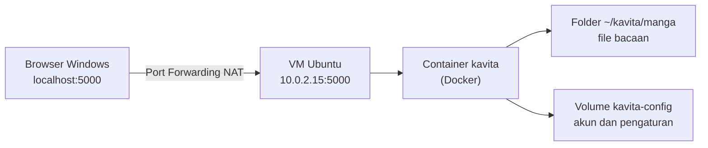

<h1 align="center">Kavita</h1>
<p align="center">Perpustakaan manga, komik, dan buku digital di server sendiri</p>

<p align="center">
  
  
  
  
  
</p>

[Sekilas Tentang](#sekilas-tentang) | [Instalasi](#instalasi) | [Konfigurasi](#konfigurasi) | [Fitur Tambahan](#fitur-tambahan) | [Maintenance](#maintenance) | [Otomatisasi](#otomatisasi) | [Cara Pemakaian](#cara-pemakaian) | [Pembahasan](#pembahasan) | [Referensi](#referensi)
:---:|:---:|:---:|:---:|:---:|:---:|:---:|:---:|:---:

> Angka dalam kurung siku, misalnya [2], merujuk ke daftar [Referensi](#referensi).
> Bagian bertanda **[BELUM]** menunggu praktik selesai. Bagian yang bisa dibuka
> ditandai panah ▶, klik untuk melihat isinya.

### Progres praktik

- [x] Docker Engine dan Compose terpasang
- [x] Folder `~/kavita/manga` dan `compose.yaml` dibuat, hasil validasi `VALID`
- [x] Image diunduh dan container berjalan
- [x] Tes dari dalam Ubuntu: `HTTP/1.1 200 OK`
- [ ] Port Forwarding VirtualBox
- [ ] Akun admin dibuat dan login berhasil
- [ ] Library dibuat, file uji terbaca
- [ ] Uji restart aplikasi dan restart Ubuntu
- [ ] Screenshot lengkap
- [ ] Pengukuran RAM dengan `docker stats`


# Sekilas Tentang
[`^ kembali ke atas ^`](#)

**Kavita** adalah aplikasi web *self-hosted* untuk membaca dan mengelola koleksi manga, webtoon, komik, dan buku digital. File ditaruh di sebuah folder, lalu Kavita memindainya menjadi *library* yang bisa dibuka lewat browser dari berbagai perangkat. Format yang didukung menurut README resminya mencakup `cbr`, `cbz`, `zip/rar/rar5`, `7zip`, gambar mentah, `epub`, dan `pdf` [2].

| Item | Keterangan |
|---|---|
| Situs dan dokumentasi | https://wiki.kavitareader.com [1] |
| Kode sumber | https://github.com/Kareadita/Kavita [2] |
| Lisensi | GNU GPL v3, gratis [2] |
| Versi yang dipasang | v0.9.1.4 (terlihat di log container) |
| Catatan pengembang | Masih berstatus beta sampai rilis 1.0.0, data bisa hilang walau tim berusaha mencegahnya [2] |

Lingkungan praktik:

| Item | Keterangan |
|---|---|
| Host | Windows 11 Home, RAM 7,9 GB |
| Virtualisasi | VirtualBox 7.2.16 |
| VM | Ubuntu 26.04.1 LTS Desktop, 8 core, RAM 4,3 GB, disk 25 GB |
| Jaringan VM | NAT, IP `10.0.2.15` |
| Docker | Engine 29.9.0, Compose v5.6.0 |
| Image | `jvmilazz0/kavita:latest` |

Alur akses dari Windows ke Kavita:




# Instalasi
[`^ kembali ke atas ^`](#)

#### Kebutuhan Sistem :
- Ubuntu dengan akses `sudo`.
- Docker Engine dan Docker Compose plugin [3].
- CPU yang mendukung SSE4.2 [1].
- Port 5000 belum dipakai program lain.
- Tidak perlu memasang web server atau database terpisah.

#### Proses Instalasi :
1. Buka terminal Ubuntu, lalu cek apakah port 5000 kosong.
    ```
    $ ss -tln | grep ':5000' || echo "Port 5000 kosong"
    ```
    Hasil di VM saya: `Port 5000 kosong`.

2. Buat folder proyek dan folder bacaan.
    ```
    $ mkdir -p ~/kavita/manga && cd ~/kavita
    ```

3. Buat file `compose.yaml`.
    ```
    $ cat > compose.yaml <<'EOF'
    services:
      kavita:
        image: jvmilazz0/kavita:latest
        container_name: kavita
        volumes:
          - ./manga:/manga
          - kavita-config:/kavita/config
        environment:
          - TZ=Asia/Jakarta
        ports:
          - "5000:5000"
        restart: unless-stopped

    volumes:
      kavita-config:
    EOF
    ```

    <details>
    <summary>▶ Penjelasan tiap baris penting</summary>

    | Baris | Fungsi |
    |---|---|
    | `./manga:/manga` | Folder bacaan di Ubuntu dipasang ke `/manga` di dalam container |
    | `kavita-config:/kavita/config` | Docker volume untuk akun, pengaturan, dan database. Path ini tidak boleh diubah [1] |
    | `TZ=Asia/Jakarta` | Zona waktu container |
    | `"5000:5000"` | Port di Ubuntu : port di container |
    | `restart: unless-stopped` | Kavita menyala otomatis setelah Ubuntu restart |

    </details>

4. Validasi isi file.
    ```
    $ sudo docker compose config -q && echo "compose.yaml VALID"
    ```
    Hasil: `compose.yaml VALID`.

5. Unduh image, lalu jalankan di latar belakang.
    ```
    $ sudo docker compose pull
    $ sudo docker compose up -d
    ```

6. Cek status container dan tes halaman dari dalam Ubuntu.
    ```
    $ sudo docker compose ps
    $ curl -sI http://localhost:5000 | head -n 1
    ```
    Hasil di VM saya: container `Up`, port 5000 `LISTEN`, dan `HTTP/1.1 200 OK`. Status kesehatan masih `health: starting` sekitar satu menit pada start pertama, karena Kavita menyiapkan database dulu.

    <details>
    <summary>▶ Kenapa log penuh kata "Fatal" dan "Error"? (bukan masalah)</summary>

    Log start pertama memuat banyak baris berlevel `Fatal` dan `Error`, padahal aplikasi berjalan normal:

    - Baris `[Fatal] ... migration ... This is not an error` adalah pesan migrasi database. Kavita menulisnya dengan level `Fatal`, dan teksnya sendiri menyatakan bukan error.
    - Baris `Unable to copy ... github_*.json` dan `DirectoryNotFoundException ... pr_cache` muncul karena file cache versi lama belum ada pada instalasi baru. Kavita menandainya `Warning` lalu melanjutkan start.

    Tanda Kavita siap ada di log: `Now listening on: http://[::]:5000` dan `Application started`.

    </details>

7. Buat aturan **Port Forwarding** di VirtualBox (di Windows, bukan di Ubuntu) **[BELUM]**.

    Buka *Settings* VM, lalu *Network*, tab *Adapter 1* (harus NAT), klik *Advanced*, lalu *Port Forwarding*. Tambah aturan:

    | Kolom | Isi |
    |---|---|
    | Name | `kavita` |
    | Protocol | `TCP` |
    | Host IP | `127.0.0.1` |
    | Host Port | `5000` |
    | Guest IP | `10.0.2.15` |
    | Guest Port | `5000` |

    Jika Host Port 5000 sudah dipakai program lain di Windows, ganti jadi `5001` dan buka `http://localhost:5001`.

8. Buka `http://localhost:5000` di browser Windows, lalu buat akun admin pertama **[BELUM]**.


# Konfigurasi
[`^ kembali ke atas ^`](#)

Pengaturan tambahan lewat `compose.yaml`. Setelah mengubah file, terapkan dengan `sudo docker compose up -d`.

| Kebutuhan | Cara |
|---|---|
| Ganti port di Ubuntu | Ubah `"5000:5000"` menjadi misalnya `"5001:5000"` |
| Zona waktu | Ubah nilai `TZ` |
| Tambah folder bacaan | Tambah baris `volumes`, misalnya `- /data/komik:/komik` |
| Batasi memori container | Tambah `mem_limit: 1g` di bawah `kavita` (belum diuji, jangan terlalu kecil) |

Batas upload tidak saya bahas karena Kavita membaca koleksi dari folder, bukan dari unggahan lewat web. Ini belum saya verifikasi di dokumentasi resmi.

Pemakaian sumber daya sebenarnya bisa dilihat dengan:
```
$ sudo docker stats --no-stream
```


# Fitur Tambahan
[`^ kembali ke atas ^`](#)

Kavita tidak memakai sistem plugin seperti CMS. Fungsi tambahannya berupa fitur bawaan atau integrasi. Daftar ini diambil dari README resmi [2] dan **belum saya coba**:

| Fungsi | Keterangan |
|---|---|
| Metadata, ulasan, rekomendasi, scrobbling | Tersedia lewat **Kavita+**, langganan berbayar |
| Manajemen pengguna | Peran, batas usia, dan OIDC |
| Tema tampilan | Repositori tema komunitas (Theme Repo) |
| Pengelompokan bacaan | Collections, Reading Lists (impor CBL), Want to Read |
| Anotasi dan highlight | Untuk file berbasis EPUB |
| Akses dari aplikasi lain | OPDS (tercantum di topik repositori) |


# Maintenance
[`^ kembali ke atas ^`](#)

Data penting ada di volume `kavita-config` dan folder `~/kavita/manga`. Karena Kavita masih beta dan data bisa hilang [2], backup rutin penting.

**Backup manual** (belum diuji):
```
$ mkdir -p ~/backup
$ sudo docker run --rm -v kavita_kavita-config:/data -v ~/backup:/backup alpine tar czf /backup/kavita-config-$(date +%F).tar.gz -C /data .
```
Nama volume `kavita_kavita-config` mengikuti nama folder proyek (`kavita`) ditambah nama volume di `compose.yaml`. Pastikan namanya dengan `sudo docker volume ls`.

**Backup tiap pekan dan hapus backup lama** (rencana, belum diuji). Buka `sudo crontab -e`, tambahkan:
```
0 2 * * 0 docker run --rm -v kavita_kavita-config:/data -v /home/wafiirbn/backup:/backup alpine tar czf /backup/kavita-config-$(date +\%F).tar.gz -C /data .
30 2 * * 0 find /home/wafiirbn/backup -name 'kavita-config-*.tar.gz' -mtime +30 -delete
```
Artinya: tiap Minggu pukul 02.00 buat backup, dan pukul 02.30 hapus backup yang lebih tua dari 30 hari. Tanda `\%` wajib di cron.

**Perintah rutin** (jalankan di `~/kavita`):
```
$ sudo docker compose ps               # cek status
$ sudo docker compose logs --tail 30   # lihat log
$ sudo docker compose restart          # restart aplikasi
$ sudo docker compose stop             # hentikan sementara, data aman
$ sudo docker compose start            # nyalakan lagi
```

> **Peringatan:** jangan jalankan `docker compose down -v`. Opsi `-v` menghapus volume sehingga semua akun dan library hilang. `docker compose down` tanpa `-v` hanya menghapus container.


# Otomatisasi
[`^ kembali ke atas ^`](#)

Instalasi di atas bisa dijalankan sekaligus dengan `script shell` [setup-kavita.sh](setup-kavita.sh). Skrip memasang Docker, membuat folder dan `compose.yaml`, menjalankan Kavita, lalu menunggu sampai merespons. Skrip belum diuji di VM baru.

```
$ bash setup-kavita.sh
```

Port Forwarding VirtualBox dan pembuatan akun admin tetap manual.

<details>
<summary>▶ Lihat isi lengkap setup-kavita.sh</summary>

```bash
#!/bin/bash
# Setup Kavita pakai Docker di Ubuntu
# Jalankan: bash setup-kavita.sh  (jangan pakai sudo di depannya)

set -e

PORT=5000
FOLDER=~/kavita

sudo apt-get update

# Install Docker dari repository resmi
sudo apt-get install -y ca-certificates curl
sudo install -m 0755 -d /etc/apt/keyrings
sudo curl -fsSL https://download.docker.com/linux/ubuntu/gpg -o /etc/apt/keyrings/docker.asc
sudo chmod a+r /etc/apt/keyrings/docker.asc
echo "deb [arch=$(dpkg --print-architecture) signed-by=/etc/apt/keyrings/docker.asc] https://download.docker.com/linux/ubuntu $(. /etc/os-release && echo ${UBUNTU_CODENAME:-$VERSION_CODENAME}) stable" | sudo tee /etc/apt/sources.list.d/docker.list > /dev/null
sudo apt-get update
sudo apt-get install -y docker-ce docker-ce-cli containerd.io docker-buildx-plugin docker-compose-plugin
sudo systemctl enable --now docker

# Siapkan folder Kavita
mkdir -p $FOLDER/manga
cd $FOLDER

# Cek port
if ss -tln | grep -q ":$PORT " && ! sudo docker ps | grep -q kavita; then
  echo "Port $PORT sudah dipakai program lain. Ganti PORT di atas lalu jalankan ulang."
  exit 1
fi

# Buat compose.yaml (kalau belum ada)
if [ ! -f compose.yaml ]; then
cat > compose.yaml <<COMPOSE
services:
  kavita:
    image: jvmilazz0/kavita:latest
    container_name: kavita
    volumes:
      - ./manga:/manga
      - kavita-config:/kavita/config
    environment:
      - TZ=Asia/Jakarta
    ports:
      - "$PORT:5000"
    restart: unless-stopped

volumes:
  kavita-config:
COMPOSE
fi

sudo docker compose config -q && echo "compose.yaml valid"

# Unduh dan jalankan
sudo docker compose pull
sudo docker compose up -d

# Tunggu Kavita siap (maksimal 3 menit)
echo "Menunggu Kavita siap..."
for i in $(seq 1 36); do
  curl -fs -o /dev/null http://localhost:$PORT && break
  sleep 5
done

sudo docker compose ps

echo ""
echo "Kavita sudah jalan di http://localhost:$PORT (dari dalam Ubuntu)"
echo "Folder bacaan : $FOLDER/manga  (di Kavita pilih folder /manga)"
echo ""
echo "Sisa langkah manual:"
echo "1. Di VirtualBox: Settings > Network > Port Forwarding"
echo "   TCP, Host IP 127.0.0.1, Host Port $PORT, Guest IP $(hostname -I | awk '{print $1}'), Guest Port $PORT"
echo "2. Buka http://localhost:$PORT di browser Windows, buat akun admin"
echo ""
echo "Jangan jalankan 'docker compose down -v', datanya hilang semua."
```

</details>


# Cara Pemakaian
[`^ kembali ke atas ^`](#)

**[BELUM]** Bagian ini diisi setelah Port Forwarding selesai dan Kavita bisa dibuka dari browser Windows. Pakai file uji milik sendiri atau berlisensi bebas, jangan kosongan.

Rencana langkah dan screenshot yang akan diambil:

| No | Langkah | Screenshot |
|---|---|---|
| 1 | Buka `http://localhost:5000`, buat akun admin | `01-akun-admin.png` |
| 2 | Taruh file uji (`.epub`, `.cbz`, `.pdf`) di `~/kavita/manga` | `02-file-uji.png` |
| 3 | Buat library, arahkan ke folder `/manga`, jalankan scan | `03-buat-library.png` |
| 4 | Library berisi file uji | `04-library.png` |
| 5 | Buka satu file di pembaca bawaan | `05-pembaca.png` |
| 6 | Buat collection atau reading list | `06-collection.png` |
| 7 | Restart aplikasi dan Ubuntu, pastikan data tetap ada | `07-setelah-restart.png` |

<details>
<summary>▶ Tempat screenshot (ganti setelah gambar tersedia)</summary>


</details>


# Pembahasan
[`^ kembali ke atas ^`](#)

Kavita ditulis dengan teknologi .NET dan dijalankan sebagai satu container. Berdasarkan praktik dan dokumentasi, ini penilaian saya.

Kelebihan :
- Instalasi singkat lewat Docker Compose: satu file konfigurasi dan dua perintah utama.
- Tidak butuh database atau web server terpisah, jadi lebih sederhana dari aplikasi PHP seperti CMS.
- Data terpisah jelas: file bacaan di folder biasa, akun dan pengaturan di Docker volume.
- Satu server untuk komik, manga, dan buku (EPUB/PDF) [2].
- Manajemen pengguna cukup lengkap: peran, batas usia, OIDC [2].
- Gratis dan berlisensi GPL v3. Fitur yang butuh layanan internet ada di langganan opsional Kavita+ [2].

Kekurangan :
- Masih beta, dan README menyebut data bisa hilang [2]. Backup wajib.
- Start pertama lama (lebih dari satu menit di VM 4,3 GB), dan log penuh kata `Fatal` dan `Error` yang bukan masalah, membingungkan pemula.
- Tidak ada konten bawaan. Kita harus punya file sendiri dari sumber yang sah.
- Harus mengurus server sendiri: instalasi, port forwarding, backup, dan pembaruan.
- Metadata dari internet bergantung pada Kavita+ yang berbayar [2].
- Pemakaian sumber daya **[BELUM]** diukur.

### Perbandingan dengan LINE WEBTOON

Pembanding yang dipilih adalah **LINE WEBTOON**, layanan baca komik yang paling dikenal pembaca di Indonesia dan tidak di-*self-host*. Keduanya sama-sama dipakai untuk membaca komik, tetapi cara kerjanya berlawanan: WEBTOON menyediakan **katalog** milik platform, sedangkan Kavita hanya menyajikan **file milik kita sendiri**.

| Aspek | Kavita | LINE WEBTOON |
|---|---|---|
| Jenis | Server pribadi, berjalan di perangkat sendiri [2] | Layanan komik online milik penyedia [4] |
| Sumber konten | File milik sendiri di folder | Katalog platform, lebih dari 7.000 karya menurut [7] |
| Cara memulai | Pasang Docker, siapkan compose, port forwarding, buat akun | Pasang aplikasi dari App Store atau Google Play [4] |
| Biaya | Gratis. Kavita+ opsional [2]. Perangkat dan waktu perawatan ditanggung sendiri | Gratis diunduh. Seri Originals gratis dibaca, Coins untuk membuka episode lebih awal lewat Fast Pass [4] |
| Contoh harga Coins | Tidak ada | Rp54.200 untuk 328 koin di reseller voucher [8] (indikatif, bukan harga resmi) |
| Akses | Browser ke server sendiri [2] | Aplikasi iOS dan Android [4] |
| Bahasa Indonesia | Antarmuka mendukung lokalisasi [2], isi tergantung file | Tersedia dalam bahasa Indonesia [7] |
| Baca offline | Tidak saya verifikasi | Bisa, episode diunduh di aplikasi [4] |
| Pembaruan konten | Kita sendiri yang menambah file | Update rutin harian atau mingguan oleh platform [4] |
| Siapa yang mengatur aturan akses | Pemilik server | Platform. Contoh: Daily Pass dihentikan, episode kini memakai Coins atau iklan [5] |
| Riwayat baca | Tersimpan di server sendiri | Tersimpan di akun pada platform |
| Risiko utama | Data bisa hilang pada versi beta, tanpa backup [2] | Katalog dan aturan akses berubah mengikuti kebijakan platform [5] |

<details>
<summary>▶ Catatan kualitas sumber perbandingan</summary>

- Halaman bantuan resmi WEBTOON yang saya baca [4] masih menyebut Daily Pass, tetapi laporan ANN [5] menyatakan fitur itu sudah dihentikan. Saya mengikuti ANN karena lebih spesifik, dan halaman bantuan kemungkinan belum diperbarui. Artikel lain [6] masih menyebut Daily Pass dan Ad Pass, jadi fitur dan syarat bisa berbeda per wilayah.
- Harga koin diambil dari reseller pihak ketiga [8], bukan dari WEBTOON, jadi hanya gambaran kasar.
- Jumlah karya (lebih dari 7.000) berasal dari artikel pihak ketiga [7] dan bisa sudah berubah.
- Kolom "Riwayat baca" adalah kesimpulan saya dari cara kerja masing-masing, bukan kutipan sumber.
- Saya tidak menguji WEBTOON secara langsung.

</details>

**Mana yang cocok?** Klik untuk melihat alur pilihannya:


<details>
<summary>▶ Uji pemahaman: Kavita atau WEBTOON?</summary>

| Kasus | Jawaban yang masuk akal | Alasan |
|---|---|---|
| Ingin membaca serial terbaru yang update tiap minggu tanpa repot | WEBTOON | Katalog dan update diurus platform [4] |
| Punya puluhan file `.cbz` dan `.epub` hasil beli tanpa DRM, ingin dibaca dari HP dan laptop | Kavita | Menyajikan file sendiri ke banyak perangkat lewat browser [2] |
| Tidak mau berurusan dengan Docker dan backup | WEBTOON | Cukup pasang aplikasi [4] |
| Tidak mau ada iklan atau Coins sama sekali pada koleksi sendiri | Kavita | Aturan akses di tangan pemilik server |

</details>

### Kesimpulan sementara

Kavita bukan pengganti WEBTOON, karena Kavita tidak punya katalog. Keduanya melayani kebutuhan yang berbeda: WEBTOON untuk membaca karya yang disediakan platform dengan mudah, Kavita untuk mengatur koleksi file sendiri dengan kontrol penuh, dengan konsekuensi mengurus server dan backup sendiri. Kesimpulan akhir akan diperbarui setelah bagian Cara Pemakaian dan pengukuran sumber daya selesai.

### Keterbatasan laporan

- Uji hanya di satu VM dengan RAM 4,3 GB, jadi angka sumber daya tidak bisa digeneralisasi.
- WEBTOON dibandingkan dari dokumentasi dan artikel, bukan dipakai langsung. Harga dan aturan akses bisa berubah per wilayah dan waktu.
- Beberapa sel tabel ditandai "tidak saya verifikasi" daripada ditebak.


# Referensi
[`^ kembali ke atas ^`](#)

Semua tautan diakses pada 10 Oktober 2026.

1. [Kavita Wiki](https://wiki.kavitareader.com) - dokumentasi resmi (Getting Started, Docker Install)
2. [Kareadita/Kavita](https://github.com/Kareadita/Kavita) - README, lisensi GPL-3.0, GitHub
3. [Install Docker Engine on Ubuntu](https://docs.docker.com/engine/install/ubuntu/) - Docker
4. [Is the WEBTOON app free?](https://help2.line.me/LINE_WEBTOON/android/categoryId/20006001/3/pc?lang=en) - LINE WEBTOON Help Center
5. [Webtoon Service Ends Daily Pass Feature](https://www.animenewsnetwork.com/news/.225053) - Anime News Network
6. [5 Daftar Situs untuk Baca Manhwa Legal Terbaik](https://www.vcgamers.com/news/?p=227942) - VCGamers
7. [Line WEBTOON](https://www.tokopedia.com/streaming/webtoon/) - Tokopedia Digital
8. [Webtoon Koin](https://www.lapakgaming.com/id-id/koin-webtoon) - Lapakgaming (reseller voucher, bukan sumber resmi)
9. Log dan keluaran terminal dari praktik sendiri di VM Ubuntu (9 sampai 10 Oktober 2026)
