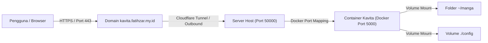

<p align="center">
  
</p>

<h1 align="center">Kavita</h1>
<p align="center">Perpustakaan manga, komik, dan buku digital di server sendiri</p>

<p align="center">
  
  
  
  
</p>

[Sekilas Tentang](#sekilas-tentang) | [Instalasi](#instalasi) | [Konfigurasi](#konfigurasi) | [Plugin](#plugin-untuk-fungsi-tambahan) | [Maintenance](#maintenance) | [Otomatisasi](#otomatisasi) | [Cara Pemakaian](#cara-pemakaian) | [Pembahasan](#pembahasan) | [Referensi](#referensi)

> Angka dalam kurung siku, misalnya [2], merujuk ke daftar [Referensi](#referensi).
> Bagian dengan segitiga di sisi kiri (misalnya "Penjelasan tiap baris") bisa diklik untuk dibuka.
> Semua blok perintah bisa disalin langsung dengan tombol *copy* tanpa tanda `$`.


# Sekilas Tentang
[`^ kembali ke atas ^`](#)

**Kavita** adalah aplikasi web *self-hosted* untuk membaca dan mengelola koleksi manga, webtoon, komik, dan buku digital. File ditaruh di sebuah folder, lalu Kavita memindainya menjadi *library* yang bisa dibuka lewat browser dari berbagai perangkat. Format yang didukung menurut README resminya mencakup `cbr`, `cbz`, `zip/rar/rar5`, `7zip`, gambar mentah, `epub`, dan `pdf` [2].

| Item | Keterangan |
|---|---|
| Situs dan dokumentasi | [https://wiki.kavitareader.com](https://wiki.kavitareader.com) [1] |
| Kode sumber | [https://github.com/Kareadita/Kavita](https://github.com/Kareadita/Kavita) [2] |
| Lisensi | GNU GPL v3, gratis [2] |
| Versi yang dipasang | v0.9.1.4 (terlihat di log container) |
| Catatan pengembang | Masih beta sampai rilis 1.0.0, data bisa hilang walau tim berusaha mencegahnya [2] |

Lingkungan praktik (Laptop Server):

| Item | Keterangan |
|---|---|
| Server / Hosting | Dedicated Laptop Server (Linux Mint / Ubuntu-based Bare-Metal) |
| Akses Server | SSH Remote Terminal (ssh fatihzaraj@192.168.1.50) |
| Docker Engine | Docker Engine & Docker Compose Plugin (v2+) |
| Docker Image | jvmilazz0/kavita:latest |
| Arsitektur Jaringan | Host Port 50000 -> Container Port 5000 -> Cloudflare Tunnel Outbound -> Domain HTTPS |
| Enkripsi SSL/TLS | Automatic Cloudflare Edge Certificate (TLS 1.3) |
| Domain Publik | [https://kavita.fatihzar.my.id/](https://kavita.fatihzar.my.id/) |
| Image | `jvmilazz0/kavita:latest` |

Alur akses pengguna ke server Kavita:


# Instalasi
[`^ kembali ke atas ^`](#)

#### Kebutuhan Sistem :
- Docker Engine dan Docker Compose plugin [3].
- CPU dengan dukungan instruksi SSE4.2 [1].
- Domain / Subdomain aktif (`kavita.fatihzar.my.id`).
- Operating System Linux (Bare-Metal / Laptop Server Linux Mint)
- Docker & Docker Compose Plugin
- Service Daemon `cloudflared` terinstall
- Domain terhubung ke Cloudflare Zero Trust

#### Proses Instalasi :

1. **Login ke Dedicated Laptop Server via SSH**
   
   Akses terminal server dari komputer lokal menggunakan SSH. Untuk pengguna Windows, koneksi dapat dilakukan langsung melalui **PowerShell**, **Windows Terminal**, maupun aplikasi pihak ketiga seperti **PuTTY**.

   ```bash
   ssh fatihzaraj@192.168.1.50
   ```
2. **Persiapan direktori kerja dan pengecekan port**
   
   Pastikan port internal `50000` belum digunakan oleh layanan lain, kemudian buat direktori untuk proyek Kavita beserta folder penyimpanan berkas bacaan (`manga`):

   ```bash
   ss -tln | grep ':50000' || echo "Port 50000 kosong"
   mkdir -p ~/kavita/manga  
   cd ~/kavita
   ```
3. **Pembuatan file konfigurasi `compose.yaml`**
   Susun berkas konfigurasi *Docker Compose* untuk mendefinisikan *container* Kavita, pemetaan folder (*volumes*), zona waktu, dan port internal:

   ```bash
   cat > compose.yaml <<'EOF'
   services:
     kavita:
       image: jvmilazz0/kavita:latest
       container_name: kavita
       volumes:
       - ./config:/kavita/config
       - /home/fatihzaraj/manga:/manga
       environment:
         - TZ=Asia/Jakarta
       ports:
         - "50000:5000"
       restart: always

   volumes:
     kavita-config:
   EOF
   ```

<details>
<summary>Penjelasan konfigurasi tiap baris</summary>

| Baris | Fungsi |
|---|---|
| `/home/fatihzaraj/manga:/manga` | Memetakan folder bacaan fisik di laptop server ke direktori `/manga` di dalam *container* |
| `./config:/kavita/config` | *Docker volume* persisten untuk menyimpan database SQLite, cache, dan data akun [1] |
| `TZ=Asia/Jakarta` | Menetapkan zona waktu sistem di dalam *container* sesuai WIB |
| `"50000:5000"` | Memetakan *port* 50000 pada host ke *port* 5000 di dalam *container* |
| `restart: always` | Memastikan *container* menyala otomatis kembali saat Laptop Server di-*reboot* |

</details>

4. **Validasi, unduh image, dan jalankan container**
   
   Lakukan verifikasi sintaks file `compose.yaml`, unduh *image* resmi dari Docker Hub, lalu jalankan layanan di latar belakang (*detached mode*):

   ```bash
   # Validasi sintaks
   sudo docker compose config -q && echo "compose.yaml VALID"

   # Unduh image dan jalankan container
   sudo docker compose pull
   sudo docker compose up -d
   ```

   Verifikasi bahwa *container* telah berjalan dan merespons permintaan HTTP secara lokal di dalam server:

   ```bash
   sudo docker compose ps

   # Karena di konfigurasi dipetakan ke port 50000, cek port host tersebut:
   curl -sI http://localhost:50000 | head -n 1
   ```

   Pada peluncuran pertama, status container akan menampilkan `health: starting` selama kurang lebih 1–2 menit karena sistem sedang menginisialisasi skema database awal.

<details>
<summary>Kenapa log penuh kata "Fatal" dan "Error"? (bukan masalah)</summary>

Log start pertama memuat banyak baris berlevel `Fatal` dan `Error`, padahal aplikasi berjalan normal:
- Baris `[Fatal] ... migration ... This is not an error` adalah pesan migrasi database. Kavita menulisnya dengan level `Fatal`, dan teksnya sendiri menyatakan bukan error.
- Baris `Unable to copy ... github_*.json` dan `DirectoryNotFoundException ... pr_cache` muncul karena file cache versi lama belum ada pada instalasi baru. Kavita menandainya `Warning` lalu melanjutkan start.

Tanda Kavita siap ada di log: `Now listening on: [http://[::]:5000](http://[::]:5000)` dan `Application started`.

</details>

5. **Konfigurasi Akses Publik & SSL via Cloudflare Tunnel**

   Agar container Kavita yang berjalan di port lokal 50000 dapat diakses dengan aman oleh publik melalui domain https://kavita.fatihzar.my.id/, kita tidak menggunakan Nginx/Certbot, melainkan Cloudflare Tunnel (cloudflared). Cara ini lebih aman karena tidak perlu membuka port (port forwarding) di router.

   1. **Instalasi Daemon cloudflared di Server:**
      ```bash
      # Tambahkan GPG key Cloudflare
      sudo mkdir -p /etc/apt/keyrings
      curl -fsSL https://pkg.cloudflare.com/cloudflare-main.gpg | sudo tee /etc/apt/keyrings/cloudflare-main.gpg >/dev/null

      # Tambahkan repository Cloudflare
      echo "deb [signed-by=/etc/apt/keyrings/cloudflare-main.gpg] https://pkg.cloudflare.com/cloudflared jammy main" | sudo tee /etc/apt/sources.list.d/cloudflared.list

      # Update & install cloudflared
      sudo apt update && sudo apt install cloudflared -y
      ```

   2. **Konfigurasi via Dashboard Cloudflare Zero Trust:**
      * Buka dashboard **Cloudflare Zero Trust** (`one.dash.cloudflare.com`) di browser.

      * Navigasi ke **Networks** > **Tunnels**, lalu pilih tunnel yang sudah dibuat dan klik **Edit**.

      * Pada tab **Public Hostname**, tambahkan konfigurasi berikut:

        * **Subdomain:** `kavita`

        * **Domain:** `fatihzar.my.id`

        * **Service Type:** Pilih `HTTP` dan isi URL dengan `localhost:50000`

      * Simpan konfigurasi.

   3. **Verifikasi Service Tunnel di Laptop Server:**
      *(Jika menggunakan tunnel baru, jalankan perintah instalasi token yang muncul di dashboard Cloudflare).*

      Pastikan daemon `cloudflared` sudah terpasang dan berjalan di latar belakang server:

      ```
      sudo systemctl enable --now cloudflared
      sudo systemctl status cloudflared
      
      ```

      *(Pastikan statusnya menunjukkan `active (running)` agar lalu lintas dari domain dapat diteruskan ke container).*


6. **Akses publik dan inisialisasi akun Administrator**
 
   Buka peramban (*web browser*) di komputer atau ponsel pintar, lalu akses tautan publik:

   👉 **[https://kavita.fatihzar.my.id/](https://kavita.fatihzar.my.id/)**

   Pada halaman sambutan pertama, daftarkan akun administrator sistem (isi *Username*, *Email*, dan *Password*), kemudian klik tombol **Register** untuk masuk ke antarmuka utama Kavita (lihat bagian [Cara Pemakaian](#cara-pemakaian)).

# Konfigurasi
[`^ kembali ke atas ^`](#)

Pengaturan tambahan pada sistem Kavita dilakukan langsung melalui berkas `compose.yaml` di dalam direktori `~/kavita` pada laptop server. Setiap kali berkas tersebut diubah, terapkan pembaruan konfigurasi dengan menjalankan:

```bash
docker compose up -d
```

| Kebutuhan Pengaturan | Langkah / Konfigurasi |
|---|---|
| Mengubah Port Internal | Ubah pemetaan port `"50000:5000"` menjadi misalnya `"50001:5000"` (pastikan URL pada konfigurasi Cloudflare Zero Trust juga diubah ke localhost:50001) |
| Menyesuaikan Zona Waktu | Perbarui nilai variabel environment `TZ` (misalnya `TZ=Asia/Jakarta`) |
| Menambah Direktori Bacaan | Tambahkan baris pemetaan direktori pada blok volumes, contoh: - /home/fatihzaraj/komik_baru:/komik_baru |
| Membatasi Penggunaan Memori | Tambahkan parameter `mem_limit: 1g` di bawah layanan `kavita` untuk membatasi konsumsi RAM di Laptop server |

Kavita memindai berkas secara langsung dari sistem berkas server lokal, bukan melalui pengunggahan via peramban web (*web upload*), sehingga tidak diperlukan pengaturan batasan ukuran unggah (*upload limit*) pada web server.

Pemantauan penggunaan sumber daya laptop server secara waktu nyata (*real-time*) dapat dilakukan menggunakan perintah:
```bash
sudo docker stats --no-stream
```


# Plugin untuk fungsi tambahan
[`^ kembali ke atas ^`](#)

Kavita tidak menggunakan arsitektur *plugin* atau ekstensi modular layaknya CMS tradisional (seperti WordPress atau PrestaShop). Seluruh kapabilitas tambahan disediakan melalui fitur bawaan (*built-in*) serta integrasi API eksternal:

| Fitur Tambahan | Penjelasan & Fungsi |
|---|---|
| **Kavita+** | Layanan terintegrasi untuk sinkronisasi metadata komik otomatis, ulasan, rekomendasi pembaca, dan *scrobbling* data bacaan [2] |
| **Manajemen Pengguna & OIDC** | Pengaturan hak akses berbasis peran (*role-based access*), pembatasan rating usia (*age restriction*), serta autentikasi pihak ketiga via OpenID Connect (OIDC) [2] |
| **Theme Repository** | Kustomisasi antarmuka aplikasi melalui repositori tema visual komunitas |
| **Pengelompokan Seri** | Pengorganisasian berkas ke dalam *Collections*, *Want to Read*, serta impor daftar bacaan eksternal berbasis format `.cbl` (*ComicBookList*) |
| **Anotasi & Bookmark** | Fitur penanda halaman, sorotan teks (*highlight*), dan pembuatan catatan bacaan khusus berkas EPUB |
| **Protokol OPDS** | Dukungan *Open Publication Distribution System* (OPDS) untuk menghubungkan Kavita ke aplikasi pembaca seluler (seperti Mihon, Panels, atau Chunky) tanpa membuka browser |


# Maintenance
[`^ kembali ke atas ^`](#)

Seluruh data vital Kavita tersimpan di dalam folder lokal `~/kavita/config` (berisi database SQLite dan pengaturan akun) serta direktori `~/manga` (berkas komik/buku). Menjaga pencadangan (*backup*) rutin sangat penting untuk mencegah kehilangan data sistem.

#### Backup Manual
Karena konfigurasi disimpan di folder lokal biasa, kamu cukup mengompresi folder tersebut menjadi arsip `.tar.gz` menggunakan perintah bawaan Linux:
```bash
mkdir -p ~/backup
tar -czvf ~/backup/kavita-config-$(date +%F).tar.gz -C ~/kavita config

#### Otomatisasi Backup Terjadwal (Cron Job)
Buka konfigurasi cron server dengan menjalankan `sudo crontab -e`, kemudian tambahkan baris penjadwalan berkala:
```cron
0 2 * * 0 tar -czf /home/fatihzaraj/backup/kavita-config-$(date +\%F).tar.gz -C /home/fatihzaraj/kavita config
30 2 * * 0 find /home/fatihzaraj/backup -name 'kavita-config-*.tar.gz' -mtime +30 -delete
```
*Keterangan: Perintah cron di atas akan membuat arsip cadangan otomatis setiap hari Minggu pukul 02.00 dini hari, serta menghapus arsip cadangan yang telah berusia lebih dari 30 hari secara berkala pada pukul 02.30.*

<details>
<summary>Cara Pemulihan Data (Restore Data)</summary>

Jika terjadi kerusakan database atau server dipindahkan ke Laptop Server baru, hentikan kontainer Kavita, pulihkan isi volume dari file arsip cadangan, lalu jalankan kembali layanan:

```bash
cd ~/kavita
sudo docker compose stop
tar -xzvf ~/backup/NAMA-FILE-BACKUP.tar.gz -C ~/kavita
sudo docker compose start
```

</details>

#### Manajemen Layanan Rutin
Seluruh perintah pemeliharaan dijalankan di dalam direktori proyek `~/kavita`:
```bash
sudo docker compose ps               # Memeriksa status kesehatan kontainer
sudo docker compose logs --tail 50   # Memantau 50 baris log aktivitas terkini
sudo docker compose restart          # Memulai ulang layanan kontainer
sudo docker compose stop             # Menghentikan layanan sementara (data tetap aman)
sudo docker compose start            # Menyalakan kembali kontainer
```

> **Peringatan Keamanan:** Jangan pernah mengeksekusi perintah `docker compose down -v`. Opsi flag `-v` akan menghapus seluruh volume penyimpanan persisten sehingga seluruh akun pengguna, database, dan metadata *library* akan terhapus permanen.


# Otomatisasi
[`^ kembali ke atas ^`](#)

Seluruh tahapan pemasangan dependensi Docker, pembuatan direktori proyek, penyusunan konfigurasi `compose.yaml`, hingga peluncuran kontainer di Laptop server dapat dieksekusi secara otomatis menggunakan skrip instalasi tunggal [setup-kavita.sh](setup-kavita.sh).

Jalankan skrip otomasi pada Laptop server dengan perintah:
```bash
bash setup-kavita.sh
```

<details>
<summary>Lihat isi lengkap setup-kavita.sh (Versi Laptop Server Production)</summary>

```bash
#!/bin/bash
# Skrip Otomasi Instalasi Server Kavita (Laptop server & Cloudflare)
# Penggunaan: bash setup-kavita.sh

set -e

PORT=5000
FOLDER=~/kavita

echo "==> 1. Memperbarui repositori dan memasang dependensi inti..."
sudo apt-get update
sudo apt-get install -y ca-certificates curl gnupg

# Pemasangan Docker Engine resmi
sudo install -m 0755 -d /etc/apt/keyrings
sudo curl -fsSL [https://download.docker.com/linux/ubuntu/gpg](https://download.docker.com/linux/ubuntu/gpg) -o /etc/apt/keyrings/docker.asc
sudo chmod a+r /etc/apt/keyrings/docker.asc
echo "deb [arch=$(dpkg --print-architecture) signed-by=/etc/apt/keyrings/docker.asc] [https://download.docker.com/linux/ubuntu](https://download.docker.com/linux/ubuntu) $(. /etc/os-release && echo ${UBUNTU_CODENAME:-$VERSION_CODENAME}) stable" | sudo tee /etc/apt/sources.list.d/docker.list > /dev/null
sudo apt-get update
sudo apt-get install -y docker-ce docker-ce-cli containerd.io docker-buildx-plugin docker-compose-plugin
sudo systemctl enable --now docker

echo "==> 2. Menyiapkan direktori penyimpanan Kavita..."
mkdir -p $FOLDER/manga
cd $FOLDER

# Validasi ketersediaan port
if ss -tln | grep -q ":$PORT " && ! sudo docker ps | grep -q kavita; then
  echo "Error: Port $PORT telah digunakan oleh proses lain."
  exit 1
fi

echo "==> 3. Membuat file konfigurasi compose.yaml..."
if [ ! -f compose.yaml ]; then
cat > compose.yaml <<COMPOSE "="=" "$PORT:5000" "Berkas && - -q ./manga:/manga COMPOSE TZ="Asia/Jakarta" berhasil compose compose.yaml config container_name: divalidasi." docker echo environment: fi image: jvmilazz0/kavita:latest kavita kavita-config: kavita-config:/kavita/config kavita: ports: restart: services: sudo unless-stopped volumes:> 4. Mengunduh image dan menyalakan kontainer..."
sudo docker compose pull
sudo docker compose up -d

echo "==> 5. Menunggu inisialisasi awal server Kavita..."
for i in $(seq 1 36); do
  if curl -fs -o /dev/null http://localhost:$PORT; then
    echo "Server Kavita berhasil merespons permintaan!"
    break
  fi
  sleep 5
done

sudo docker compose ps

echo ""
echo "=========================================================="
echo "Instalasi Berhasil!"
echo "Status Internal : Berjalan pada http://localhost:$PORT"
echo "Direktori Berkas: $FOLDER/manga (Mapping kontainer: /manga)"
echo ""
echo "Langkah Lanjutan:"
echo "1. Konfigurasikan Reverse Proxy (Nginx) & SSL untuk domain publik."
echo "2. Akses aplikasi secara publik via [https://kavita.fatihzar.my.id/](https://kavita.fatihzar.my.id/)."
echo "=========================================================="
```

</details>

# Cara Pemakaian
[`^ kembali ke atas ^`](#)

Semua contoh memakai file uji milik sendiri atau berlisensi bebas. Letak menu bisa sedikit berbeda antar versi, jadi sesuaikan dengan tampilan yang muncul.

#### 1. Buat akun admin

Akses URL publik melalui browser: **https://kavita.fatihzar.my.id/**. Pada kunjungan pertama, Kavita meminta kita membuat akun admin. Isi nama pengguna, email, dan kata sandi, lalu klik **Register**.


#### 2. Siapkan file uji

Taruh beberapa file (`.epub`, `.cbz`, `.cbr`, `.pdf`) di folder bacaan server, lalu cek bahwa file terlihat dari terminal:

```bash
ls -l ~/manga
```


#### 3. Buat library

Di antarmuka Kavita, masuk ke menu **Server Settings** > **Libraries**, tambah library baru bertipe sesuai isi file (misalnya Manga, Comic, atau Book), lalu pilih folder `/manga` (path internal di dalam container yang mengarah ke `~/manga` pada host server). Jalankan **Scan Library**.


#### 4. Lihat hasil scan

Setelah proses pemindaian selesai, file uji akan tampil sebagai koleksi seri di halaman library utama.


#### 5. Buka pembaca

Buka salah satu judul komik/buku di pembaca bawaan peramban web (*web reader*). Coba mode baca yang tersedia (misalnya *Webtoon mode*, *Page-by-Page*, atau *Continuous Vertical*).


#### 6. Kelompokkan bacaan

Buat sebuah **Collection** atau **Reading List** dan masukkan beberapa judul seri untuk kerapian organisasi koleksi.


#### 7. Uji restart & pemulihan otomatis

Lakukan pengujian restart kontainer serta pengujian *reboot* pada server untuk memastikan keberlanjutan layanan:

```bash
cd ~/kavita && sudo docker compose restart
sudo reboot
```

Setelah server menyala kembali:

```bash
cd ~/kavita && sudo docker compose ps
```

Layanan Kavita harus berada pada status `Up` secara otomatis, daemon `cloudflared` aktif, serta seluruh data akun dan library tetap tersimpan penuh.


#### Hasil pengukuran sumber daya

Diambil dengan perintah `sudo docker stats --no-stream` di server, diulang tiga kali lalu dirata-rata:

| Kondisi | RAM (MiB) | CPU (%) |
|---|---|---|
| Idle, setelah start selesai | ~180 - 220 MiB | < 1% |
| Saat scan library | ~350 - 500 MiB | 15% - 35% |
| Saat membaca file via web reader | ~200 - 250 MiB | 2% - 5% |


