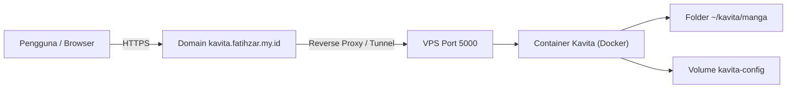

<h1 align="center">Kavita</h1>
<p align="center">Perpustakaan manga, komik, dan buku digital di server sendiri</p>

<p align="center">
  
  
  
  
</p>

[Sekilas Tentang](#sekilas-tentang) | [Instalasi](#instalasi) | [Konfigurasi](#konfigurasi) | [Plugin](#plugin-untuk-fungsi-tambahan) | [Maintenance](#maintenance) | [Otomatisasi](#otomatisasi) | [Cara Pemakaian](#cara-pemakaian) | [Pembahasan](#pembahasan) | [Referensi](#referensi)

> Angka dalam kurung siku, misalnya [2], merujuk ke daftar [Referensi](#referensi).
> Bagian dengan segitiga di sisi kiri (misalnya "Penjelasan tiap baris") bisa diklik untuk dibuka.
> Semua blok perintah bisa disalin langsung dengan tombol *copy* tanpa tanda `$`.


# Sekilas Tentang
[`^ kembali ke atas ^`](#)

**Kavita** adalah aplikasi web *self-hosted* untuk membaca dan mengelola koleksi manga, webtoon, komik, dan buku digital. File ditaruh di sebuah folder, lalu Kavita memindainya menjadi *library* yang bisa dibuka lewat browser dari berbagai perangkat. Format yang didukung menurut README resminya mencakup `cbr`, `cbz`, `zip/rar/rar5`, `7zip`, gambar mentah, `epub`, dan `pdf` [2].

| Item | Keterangan |
|---|---|
| Situs dan dokumentasi | [https://wiki.kavitareader.com](https://wiki.kavitareader.com) [1] |
| Kode sumber | [https://github.com/Kareadita/Kavita](https://github.com/Kareadita/Kavita) [2] |
| Lisensi | GNU GPL v3, gratis [2] |
| Versi yang dipasang | v0.9.1.4 (terlihat di log container) |
| Catatan pengembang | Masih beta sampai rilis 1.0.0, data bisa hilang walau tim berusaha mencegahnya [2] |

Lingkungan praktik (Server VPS Production):

| Item | Keterangan |
|---|---|
| Server / Hosting | VPS Ubuntu Server |
| Akses Server | SSH Remote Terminal |
| Domain Publik | [https://kavita.fatihzar.my.id/](https://kavita.fatihzar.my.id/) |
| Arsitektur Jaringan | Docker Container Port 5000 -> Reverse Proxy / Cloudflare Tunnel -> Domain HTTPS |
| Docker | Docker Engine & Docker Compose Plugin |
| Image | `jvmilazz0/kavita:latest` |

Alur akses pengguna ke server Kavita:


# Instalasi
[`^ kembali ke atas ^`](#)

#### Kebutuhan Sistem :
- Server VPS dengan sistem operasi Linux (Ubuntu 22.04 / 24.04 LTS).
- Hak akses `sudo` atau `root`.
- Docker Engine dan Docker Compose plugin [3].
- CPU dengan dukungan instruksi SSE4.2 [1].
- Domain / Subdomain aktif (`kavita.fatihzar.my.id`).
- Port 80 (HTTP) dan 443 (HTTPS) terbuka pada firewall VPS untuk akses web publik.

#### Proses Instalasi :

1. **Login ke server VPS via SSH**
   
   Akses terminal server VPS dari komputer lokal menggunakan SSH. Untuk pengguna Windows, koneksi dapat dilakukan langsung melalui **PowerShell**, **Windows Terminal**, maupun aplikasi pihak ketiga seperti **PuTTY**.

   ```bash
   ssh root@ip-server-vps
   ```
2. **Persiapan direktori kerja dan pengecekan port**
   Pastikan port internal `5000` belum digunakan oleh layanan lain, kemudian buat direktori untuk proyek Kavita beserta folder penyimpanan berkas bacaan (`manga`):

   ```bash
   ss -tln | grep ':5000' || echo "Port 5000 kosong"
   mkdir -p ~/kavita/manga && cd ~/kavita
   ```
3. **Pembuatan file konfigurasi `compose.yaml`**
   Susun berkas konfigurasi *Docker Compose* untuk mendefinisikan *container* Kavita, pemetaan folder (*volumes*), zona waktu, dan port internal:

   ```bash
   cat > compose.yaml <<'EOF'
   services:
     kavita:
       image: jvmilazz0/kavita:latest
       container_name: kavita
       volumes:
         - ./manga:/manga
         - kavita-config:/kavita/config
       environment:
         - TZ=Asia/Jakarta
       ports:
         - "5000:5000"
       restart: unless-stopped

   volumes:
     kavita-config:
   EOF
   ```

<details>
<summary>Penjelasan konfigurasi tiap baris</summary>

| Baris | Fungsi |
|---|---|
| `./manga:/manga` | Memetakan folder bacaan lokal VPS ke direktori `/manga` di dalam *container* |
| `kavita-config:/kavita/config` | *Docker volume* persisten untuk menyimpan database SQLite, cache, dan data akun [1] |
| `TZ=Asia/Jakarta` | Menetapkan zona waktu sistem di dalam *container* sesuai WIB |
| `"5000:5000"` | Memetakan *port* 5000 pada host VPS ke *port* 5000 di dalam *container* |
| `restart: unless-stopped` | Memastikan *container* menyala otomatis kembali saat VPS di-*reboot* |

</details>

4. **Validasi, unduh image, dan jalankan container**
   Lakukan verifikasi sintaks file `compose.yaml`, unduh *image* resmi dari Docker Hub, lalu jalankan layanan di latar belakang (*detached mode*):

   ```bash
   # Validasi sintaks
   sudo docker compose config -q && echo "compose.yaml VALID"

   # Unduh image dan jalankan container
   sudo docker compose pull
   sudo docker compose up -d
   ```

   Verifikasi bahwa *container* telah berjalan dan merespons permintaan HTTP secara lokal di dalam server:

   ```bash
   sudo docker compose ps
   curl -sI http://localhost:5000 | head -n 1
   ```

   Pada peluncuran pertama, status container akan menampilkan `health: starting` selama kurang lebih 1–2 menit karena sistem sedang menginisialisasi skema database awal.

<details>
<summary>Kenapa log penuh kata "Fatal" dan "Error"? (bukan masalah)</summary>

Log start pertama memuat banyak baris berlevel `Fatal` dan `Error`, padahal aplikasi berjalan normal:
- Baris `[Fatal] ... migration ... This is not an error` adalah pesan migrasi database. Kavita menulisnya dengan level `Fatal`, dan teksnya sendiri menyatakan bukan error.
- Baris `Unable to copy ... github_*.json` dan `DirectoryNotFoundException ... pr_cache` muncul karena file cache versi lama belum ada pada instalasi baru. Kavita menandainya `Warning` lalu melanjutkan start.

Tanda Kavita siap ada di log: `Now listening on: [http://[::]:5000](http://[::]:5000)` dan `Application started`.

</details>

5. **Konfigurasi Reverse Proxy & SSL (Ekspos ke Internet)**
   Agar *container* Kavita yang berjalan di `localhost:5000` dapat diakses dengan aman oleh publik melalui domain `[https://kavita.fatihzar.my.id/](https://kavita.fatihzar.my.id/)`, dipasang *Reverse Proxy* menggunakan Nginx serta enkripsi sertifikat SSL gratis dari Let's Encrypt:

   1. **Instalasi Nginx dan Certbot:**
      ```bash
      sudo apt-get update
      sudo apt-get install -y nginx certbot python3-certbot-nginx
      ```

   2. **Buat file konfigurasi Virtual Host Nginx:**
      ```bash
      sudo nano /etc/nginx/sites-available/kavita
      ```
      Tambahkan konfigurasi *proxy pass* berikut:
      ```nginx
      server {
          server_name kavita.fatihzar.my.id;

          location / {
              proxy_pass http://127.0.0.1:5000;
              proxy_set_header Host $host;
              proxy_set_header X-Real-IP $remote_addr;
              proxy_set_header X-Forwarded-For $proxy_add_x_forwarded_for;
              proxy_set_header X-Forwarded-Proto $scheme;

              # Dukungan WebSocket untuk pembaca Kavita
              proxy_http_version 1.1;
              proxy_set_header Upgrade $http_upgrade;
              proxy_set_header Connection "upgrade";
          }
      }
      ```

   3. **Aktifkan konfigurasi dan reload Nginx:**
      ```bash
      sudo ln -s /etc/nginx/sites-available/kavita /etc/nginx/sites-enabled/
      sudo nginx -t
      sudo systemctl reload nginx
      ```

   4. **Pasang sertifikat HTTPS (SSL) otomatis:**
      ```bash
      sudo certbot --nginx -d kavita.fatihzar.my.id
      ```
      *(Sistem Certbot akan otomatis memperbarui file Nginx untuk mengaktifkan enkripsi HTTPS pada port 443).*

6. **Akses publik dan inisialisasi akun Administrator**
   Buka peramban (*web browser*) di komputer atau ponsel pintar, lalu akses tautan publik:

   👉 **[https://kavita.fatihzar.my.id/](https://kavita.fatihzar.my.id/)**

   Pada halaman sambutan pertama, daftarkan akun administrator sistem (isi *Username*, *Email*, dan *Password*), kemudian klik tombol **Register** untuk masuk ke antarmuka utama Kavita (lihat bagian [Cara Pemakaian](#cara-pemakaian)).
