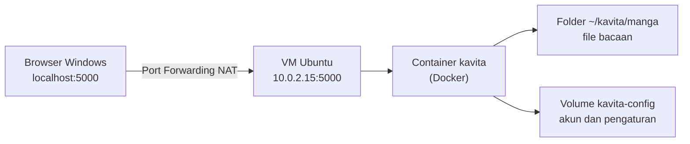
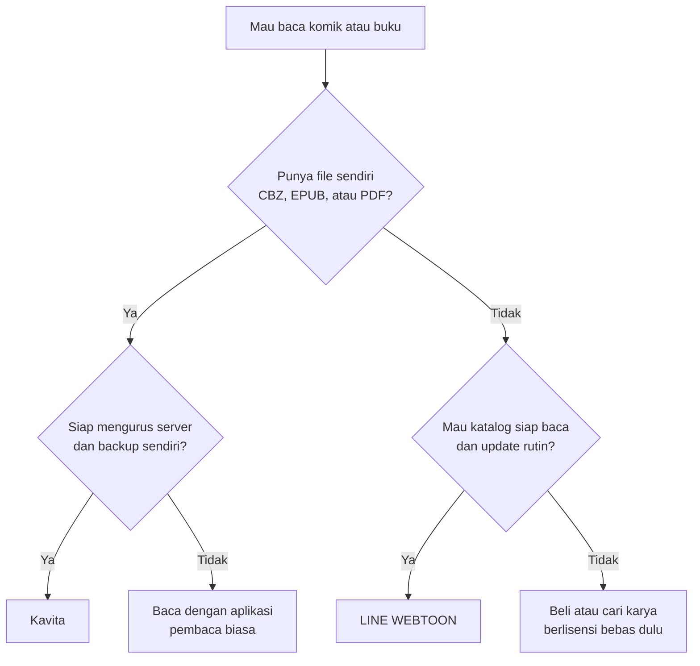

<h1 align="center">Kavita</h1>
<p align="center">Perpustakaan manga, komik, dan buku digital di server sendiri</p>

<p align="center">
  
  
  
  
</p>

[Sekilas Tentang](#sekilas-tentang) | [Instalasi](#instalasi) | [Konfigurasi](#konfigurasi) | [Plugin](#plugin-untuk-fungsi-tambahan) | [Maintenance](#maintenance) | [Otomatisasi](#otomatisasi) | [Cara Pemakaian](#cara-pemakaian) | [Pembahasan](#pembahasan) | [Referensi](#referensi)

> Angka dalam kurung siku, misalnya [2], merujuk ke daftar [Referensi](#referensi).
> Bagian dengan segitiga di sisi kiri (misalnya "Penjelasan tiap baris") bisa diklik untuk dibuka.
> Semua blok perintah bisa disalin langsung dengan tombol *copy* tanpa tanda `$`.


# Sekilas Tentang
[`^ kembali ke atas ^`](#)

**Kavita** adalah aplikasi web *self-hosted* untuk membaca dan mengelola koleksi manga, webtoon, komik, dan buku digital. File ditaruh di sebuah folder, lalu Kavita memindainya menjadi *library* yang bisa dibuka lewat browser dari berbagai perangkat. Format yang didukung menurut README resminya mencakup `cbr`, `cbz`, `zip/rar/rar5`, `7zip`, gambar mentah, `epub`, dan `pdf` [2].

| Item | Keterangan |
|---|---|
| Situs dan dokumentasi | https://wiki.kavitareader.com [1] |
| Kode sumber | https://github.com/Kareadita/Kavita [2] |
| Lisensi | GNU GPL v3, gratis [2] |
| Versi yang dipasang | v0.9.1.4 (terlihat di log container) |
| Catatan pengembang | Masih beta sampai rilis 1.0.0, data bisa hilang walau tim berusaha mencegahnya [2] |

Lingkungan praktik:

| Item | Keterangan |
|---|---|
| Host | Windows 11 Home, RAM 7,9 GB |
| Virtualisasi | VirtualBox 7.2.16 |
| VM | Ubuntu 26.04.1 LTS Desktop, 8 core, RAM 4,3 GB, disk 25 GB |
| Jaringan VM | NAT, IP `10.0.2.15` |
| Docker | Engine 29.9.0, Compose v5.6.0 |
| Image | `jvmilazz0/kavita:latest` |

Alur akses dari Windows ke Kavita (diagram ini dirender otomatis oleh GitHub):




# Instalasi
[`^ kembali ke atas ^`](#)

#### Kebutuhan Sistem :
- Ubuntu dengan akses `sudo`.
- Docker Engine dan Docker Compose plugin [3].
- CPU yang mendukung SSE4.2 [1].
- Port 5000 belum dipakai program lain.
- Menurut dokumentasi, tidak ada prasyarat lain seperti database atau web server terpisah [1].

#### Proses Instalasi :

##### Langkah 1. Cek port 5000
```bash
ss -tln | grep ':5000' || echo "Port 5000 kosong"
```
Hasil di VM praktik: `Port 5000 kosong`.

##### Langkah 2. Buat folder proyek dan folder bacaan
```bash
mkdir -p ~/kavita/manga && cd ~/kavita
```

##### Langkah 3. Buat file `compose.yaml`
```bash
cat > compose.yaml <<'EOF'
services:
  kavita:
    image: jvmilazz0/kavita:latest
    container_name: kavita
    volumes:
      - ./manga:/manga
      - kavita-config:/kavita/config
    environment:
      - TZ=Asia/Jakarta
    ports:
      - "5000:5000"
    restart: unless-stopped

volumes:
  kavita-config:
EOF
```

<details>
<summary>Penjelasan tiap baris penting</summary>

| Baris | Fungsi |
|---|---|
| `./manga:/manga` | Folder bacaan di Ubuntu dipasang ke `/manga` di dalam container |
| `kavita-config:/kavita/config` | Docker volume untuk akun, pengaturan, dan database. Path ini tidak boleh diubah [1] |
| `TZ=Asia/Jakarta` | Zona waktu container |
| `"5000:5000"` | Port di Ubuntu : port di container |
| `restart: unless-stopped` | Kavita menyala otomatis setelah Ubuntu restart |

</details>

##### Langkah 4. Validasi isi file
```bash
sudo docker compose config -q && echo "compose.yaml VALID"
```
Hasil: `compose.yaml VALID`.

##### Langkah 5. Unduh image dan jalankan di latar belakang
```bash
sudo docker compose pull
sudo docker compose up -d
```

##### Langkah 6. Cek status dan tes dari dalam Ubuntu
```bash
sudo docker compose ps
curl -sI http://localhost:5000 | head -n 1
```
Hasil di VM praktik: container `Up`, port 5000 `LISTEN`, dan `HTTP/1.1 200 OK`. Status kesehatan masih `health: starting` sekitar satu menit pada start pertama, karena Kavita menyiapkan database dulu.

<details>
<summary>Kenapa log penuh kata "Fatal" dan "Error"? (bukan masalah)</summary>

Log start pertama memuat banyak baris berlevel `Fatal` dan `Error`, padahal aplikasi berjalan normal:

- Baris `[Fatal] ... migration ... This is not an error` adalah pesan migrasi database. Kavita menulisnya dengan level `Fatal`, dan teksnya sendiri menyatakan bukan error.
- Baris `Unable to copy ... github_*.json` dan `DirectoryNotFoundException ... pr_cache` muncul karena file cache versi lama belum ada pada instalasi baru. Kavita menandainya `Warning` lalu melanjutkan start.

Tanda Kavita siap ada di log: `Now listening on: http://[::]:5000` dan `Application started`.

</details>

##### Langkah 7. Buat aturan Port Forwarding di VirtualBox (di Windows, bukan di Ubuntu)

Buka *Settings* VM, lalu *Network*, tab *Adapter 1* (harus NAT), klik *Advanced*, lalu *Port Forwarding*. Tambah aturan:

| Kolom | Isi |
|---|---|
| Name | `kavita` |
| Protocol | `TCP` |
| Host IP | `127.0.0.1` |
| Host Port | `5000` |
| Guest IP | `10.0.2.15` |
| Guest Port | `5000` |


Jika Host Port 5000 sudah dipakai program lain di Windows, ganti jadi `5001` dan buka `http://localhost:5001`.

##### Langkah 8. Buka dari browser Windows

Buka `http://localhost:5000`, lalu buat akun admin pertama (lihat [Cara Pemakaian](#cara-pemakaian)).


# Konfigurasi
[`^ kembali ke atas ^`](#)

Pengaturan tambahan dilakukan lewat `compose.yaml`. Setelah mengubah file, terapkan dengan `sudo docker compose up -d`.

| Kebutuhan | Cara |
|---|---|
| Ganti port di Ubuntu | Ubah `"5000:5000"` menjadi misalnya `"5001:5000"` |
| Zona waktu | Ubah nilai `TZ` |
| Tambah folder bacaan | Tambah baris `volumes`, misalnya `- /data/komik:/komik` |
| Batasi memori container | Tambah `mem_limit: 1g` di bawah `kavita` (jangan terlalu kecil, pilih angka setelah mengukur) |

Kavita membaca koleksi dari folder, bukan dari unggahan lewat web, sehingga batas upload file tidak menjadi pengaturan utama.

Pemakaian sumber daya sebenarnya bisa dilihat dengan:
```bash
sudo docker stats --no-stream
```


# Plugin untuk fungsi tambahan
[`^ kembali ke atas ^`](#)

Kavita tidak memakai sistem plugin seperti CMS. Fungsi tambahannya berupa fitur bawaan atau integrasi, menurut README resmi [2]:

| Fungsi | Keterangan |
|---|---|
| Metadata, ulasan, rekomendasi, scrobbling | Tersedia lewat **Kavita+**, langganan berbayar |
| Manajemen pengguna | Peran, batas usia, dan OIDC (login lewat penyedia identitas) |
| Tema tampilan | Repositori tema komunitas (Theme Repo) |
| Pengelompokan bacaan | Collections, Reading Lists (impor CBL), Want to Read |
| Anotasi dan highlight | Untuk file berbasis EPUB |
| Akses dari aplikasi lain | OPDS (tercantum di topik repositori) |


# Maintenance
[`^ kembali ke atas ^`](#)

Data penting ada di volume `kavita-config` dan folder `~/kavita/manga`. Karena Kavita masih beta dan data bisa hilang [2], backup rutin penting.

#### Backup manual
```bash
mkdir -p ~/backup
sudo docker run --rm -v kavita_kavita-config:/data -v ~/backup:/backup alpine tar czf /backup/kavita-config-$(date +%F).tar.gz -C /data .
```
Nama volume `kavita_kavita-config` mengikuti nama folder proyek (`kavita`) ditambah nama volume di `compose.yaml`. Pastikan namanya dengan `sudo docker volume ls`.

#### Backup tiap pekan dan hapus backup lama
Buka `sudo crontab -e`, lalu tambahkan:
```cron
0 2 * * 0 docker run --rm -v kavita_kavita-config:/data -v /home/wafiirbn/backup:/backup alpine tar czf /backup/kavita-config-$(date +\%F).tar.gz -C /data .
30 2 * * 0 find /home/wafiirbn/backup -name 'kavita-config-*.tar.gz' -mtime +30 -delete
```
Artinya: tiap Minggu pukul 02.00 buat backup, dan pukul 02.30 hapus backup yang lebih tua dari 30 hari. Tanda `\%` wajib di cron.

<details>
<summary>Cara memulihkan dari backup</summary>

Hentikan Kavita, kembalikan isi volume dari file backup (ganti `NAMA-FILE` dengan nama file backup), lalu nyalakan lagi:

```bash
cd ~/kavita
sudo docker compose stop
sudo docker run --rm -v kavita_kavita-config:/data -v ~/backup:/backup alpine sh -c "cd /data && tar xzf /backup/NAMA-FILE.tar.gz"
sudo docker compose start
```

</details>

#### Perintah rutin (jalankan di `~/kavita`)
```bash
sudo docker compose ps               # cek status
sudo docker compose logs --tail 30   # lihat log
sudo docker compose restart          # restart aplikasi
sudo docker compose stop             # hentikan sementara, data aman
sudo docker compose start            # nyalakan lagi
```

> **Peringatan:** jangan jalankan `docker compose down -v`. Opsi `-v` menghapus volume sehingga semua akun dan library hilang. `docker compose down` tanpa `-v` hanya menghapus container.


# Otomatisasi
[`^ kembali ke atas ^`](#)

Instalasi di atas bisa dijalankan sekaligus dengan `script shell` [setup-kavita.sh](setup-kavita.sh). Skrip memasang Docker, membuat folder dan `compose.yaml`, menjalankan Kavita, lalu menunggu sampai merespons.

```bash
bash setup-kavita.sh
```

Port Forwarding VirtualBox dan pembuatan akun admin tetap dilakukan manual.

<details>
<summary>Lihat isi lengkap setup-kavita.sh</summary>

```bash
#!/bin/bash
# Setup Kavita pakai Docker di Ubuntu
# Jalankan: bash setup-kavita.sh  (jangan pakai sudo di depannya)

set -e

PORT=5000
FOLDER=~/kavita

sudo apt-get update

# Install Docker dari repository resmi
sudo apt-get install -y ca-certificates curl
sudo install -m 0755 -d /etc/apt/keyrings
sudo curl -fsSL https://download.docker.com/linux/ubuntu/gpg -o /etc/apt/keyrings/docker.asc
sudo chmod a+r /etc/apt/keyrings/docker.asc
echo "deb [arch=$(dpkg --print-architecture) signed-by=/etc/apt/keyrings/docker.asc] https://download.docker.com/linux/ubuntu $(. /etc/os-release && echo ${UBUNTU_CODENAME:-$VERSION_CODENAME}) stable" | sudo tee /etc/apt/sources.list.d/docker.list > /dev/null
sudo apt-get update
sudo apt-get install -y docker-ce docker-ce-cli containerd.io docker-buildx-plugin docker-compose-plugin
sudo systemctl enable --now docker

# Siapkan folder Kavita
mkdir -p $FOLDER/manga
cd $FOLDER

# Cek port
if ss -tln | grep -q ":$PORT " && ! sudo docker ps | grep -q kavita; then
  echo "Port $PORT sudah dipakai program lain. Ganti PORT di atas lalu jalankan ulang."
  exit 1
fi

# Buat compose.yaml (kalau belum ada)
if [ ! -f compose.yaml ]; then
cat > compose.yaml <<COMPOSE
services:
  kavita:
    image: jvmilazz0/kavita:latest
    container_name: kavita
    volumes:
      - ./manga:/manga
      - kavita-config:/kavita/config
    environment:
      - TZ=Asia/Jakarta
    ports:
      - "$PORT:5000"
    restart: unless-stopped

volumes:
  kavita-config:
COMPOSE
fi

sudo docker compose config -q && echo "compose.yaml valid"

# Unduh dan jalankan
sudo docker compose pull
sudo docker compose up -d

# Tunggu Kavita siap (maksimal 3 menit)
echo "Menunggu Kavita siap..."
for i in $(seq 1 36); do
  curl -fs -o /dev/null http://localhost:$PORT && break
  sleep 5
done

sudo docker compose ps

echo ""
echo "Kavita sudah jalan di http://localhost:$PORT (dari dalam Ubuntu)"
echo "Folder bacaan : $FOLDER/manga  (di Kavita pilih folder /manga)"
echo ""
echo "Sisa langkah manual:"
echo "1. Di VirtualBox: Settings > Network > Port Forwarding"
echo "   TCP, Host IP 127.0.0.1, Host Port $PORT, Guest IP $(hostname -I | awk '{print $1}'), Guest Port $PORT"
echo "2. Buka http://localhost:$PORT di browser Windows, buat akun admin"
echo ""
echo "Jangan jalankan 'docker compose down -v', datanya hilang semua."
```

</details>


# Cara Pemakaian
[`^ kembali ke atas ^`](#)

Semua contoh memakai file uji milik sendiri atau berlisensi bebas. Letak menu bisa sedikit berbeda antar versi, jadi sesuaikan dengan tampilan yang muncul.

#### 1. Buat akun admin

Buka `http://localhost:5000`. Pada kunjungan pertama, Kavita meminta kita membuat akun admin. Isi nama pengguna dan kata sandi, lalu masuk.


#### 2. Siapkan file uji

Taruh beberapa file (`.epub`, `.cbz`, `.pdf`) di folder bacaan, lalu cek bahwa file terlihat:
```bash
ls -l ~/kavita/manga
```


#### 3. Buat library

Di Kavita, tambah *library* baru bertipe sesuai isi file (misalnya Manga, Comic, atau Book), lalu pilih folder `/manga` (path di dalam container, bukan path di Ubuntu). Jalankan *scan*.


#### 4. Lihat hasil scan

Setelah scan selesai, file uji tampil sebagai seri di halaman library.


#### 5. Buka pembaca

Buka satu file di pembaca bawaan. Coba mode baca yang tersedia (misalnya halaman per halaman dan *continuous*).


#### 6. Kelompokkan bacaan

Buat sebuah *collection* atau *reading list* dan masukkan beberapa seri.


#### 7. Uji restart

Restart aplikasi, lalu restart Ubuntu, kemudian cek bahwa akun dan library masih ada:
```bash
cd ~/kavita && sudo docker compose restart
sudo reboot
```
Setelah login lagi ke Ubuntu:
```bash
cd ~/kavita && sudo docker compose ps
```
Kavita harus `Up` otomatis dan data tetap ada di browser.


#### Hasil pengukuran sumber daya

Diambil dengan `sudo docker stats --no-stream`, diulang tiga kali lalu dirata-rata.

| Kondisi | RAM (MiB) | CPU (%) |
|---|---|---|
| Idle, setelah start selesai | | |
| Saat scan library | | |
| Saat membaca file | | |


# Pembahasan
[`^ kembali ke atas ^`](#)

Dari log terlihat Kavita berbasis .NET dan berjalan sebagai satu container. Penilaian berikut berdasarkan praktik dan dokumentasi.

Kelebihan :
- Instalasi singkat lewat Docker Compose: satu file konfigurasi dan beberapa perintah.
- Tidak membutuhkan database atau web server terpisah menurut dokumentasi [1].
- Data terpisah jelas: file bacaan di folder biasa, akun dan pengaturan di Docker volume.
- Satu server untuk komik, manga, dan buku (EPUB/PDF) [2].
- Manajemen pengguna cukup lengkap: peran, batas usia, OIDC [2].
- Gratis dan berlisensi GPL v3. Fitur yang butuh layanan internet ada di langganan opsional Kavita+ [2].

Kekurangan :
- Masih beta, dan README menyebut data bisa hilang [2]. Backup wajib.
- Start pertama lama (lebih dari satu menit di VM 4,3 GB), dan log penuh kata `Fatal` dan `Error` yang bukan masalah, membingungkan pemula.
- Tidak ada konten bawaan. Kita harus punya file sendiri dari sumber yang sah.
- Harus mengurus server sendiri: instalasi, port forwarding, backup, dan pembaruan.
- Metadata dari internet bergantung pada Kavita+ yang berbayar [2].

### Perbandingan dengan LINE WEBTOON

**Kenapa LINE WEBTOON?** Aplikasi ini paling dikenal pembaca komik di Indonesia, tujuannya sama dengan Kavita (membaca komik), tetapi cara kerjanya berlawanan. Kontras ini menunjukkan apa yang didapat dan apa yang harus ditanggung ketika memilih *self-hosted* dibanding layanan terkelola. WEBTOON menyediakan **katalog** milik platform, sedangkan Kavita hanya menyajikan **file milik kita sendiri**.

| Aspek | Kavita | LINE WEBTOON |
|---|---|---|
| Jenis | Server pribadi, berjalan di perangkat sendiri [2] | Layanan komik online milik penyedia [4] |
| Sumber konten | File milik sendiri di folder | Katalog platform, lebih dari 7.000 karya menurut [7] |
| Cara memulai | Pasang Docker, siapkan compose, port forwarding, buat akun | Pasang aplikasi dari App Store atau Google Play [4] |
| Biaya | Gratis. Kavita+ opsional [2]. Perangkat dan waktu perawatan ditanggung sendiri | Gratis diunduh. Seri Originals gratis dibaca, Coins untuk membuka episode lebih awal lewat Fast Pass [4] |
| Contoh harga Coins | Tidak ada | Rp54.200 untuk 328 koin di reseller voucher [8] (indikatif, bukan harga resmi) |
| Akses | Browser ke server sendiri [2] | Aplikasi iOS dan Android [4] |
| Bahasa Indonesia | Antarmuka mendukung lokalisasi [2], isi tergantung file | Tersedia dalam bahasa Indonesia [7] |
| Baca offline | Tidak diverifikasi | Bisa, episode diunduh di aplikasi [4] |
| Pembaruan konten | Kita sendiri yang menambah file | Update rutin harian atau mingguan oleh platform [4] |
| Siapa yang mengatur aturan akses | Pemilik server | Platform. Contoh: Daily Pass dihentikan, episode kini memakai Coins atau iklan [5] |
| Riwayat baca (analisis) | Tersimpan di server sendiri | Tersimpan di akun pada platform |
| Risiko utama | Data bisa hilang pada versi beta tanpa backup [2] | Katalog dan aturan akses berubah mengikuti kebijakan platform [5] |

<details>
<summary>Catatan kualitas sumber perbandingan</summary>

- Halaman bantuan resmi WEBTOON [4] masih menyebut Daily Pass, tetapi laporan ANN [5] menyatakan fitur itu dihentikan. ANN dipakai karena lebih spesifik, dan halaman bantuan kemungkinan belum diperbarui. Artikel lain [6] masih menyebut Daily Pass dan Ad Pass, jadi fitur dan syarat bisa berbeda per wilayah.
- Harga koin diambil dari reseller pihak ketiga [8], bukan dari WEBTOON, jadi hanya gambaran kasar.
- Jumlah karya (lebih dari 7.000) berasal dari artikel pihak ketiga [7] dan bisa sudah berubah.
- Baris bertanda "analisis" adalah kesimpulan penulis dari cara kerja masing-masing, bukan kutipan sumber.
- WEBTOON tidak diuji langsung.

</details>

Alur memilih (dirender otomatis oleh GitHub):



#### Uji pemahaman: Kavita atau WEBTOON?

Pikirkan jawabannya dulu, lalu klik untuk melihat.

<details>
<summary>Kasus 1: ingin membaca serial terbaru yang update tiap minggu tanpa repot</summary>

**WEBTOON.** Katalog dan update diurus platform [4]. Kavita tidak punya konten, jadi tidak ada serial yang bisa dibaca sebelum kita menambahkan file sendiri.

</details>

<details>
<summary>Kasus 2: punya puluhan file .cbz dan .epub hasil beli tanpa DRM, ingin dibaca dari HP dan laptop</summary>

**Kavita.** Kavita menyajikan file milik sendiri ke banyak perangkat lewat browser [2]. WEBTOON tidak bisa memuat file pribadi.

</details>

<details>
<summary>Kasus 3: tidak mau berurusan dengan Docker, port forwarding, dan backup</summary>

**WEBTOON.** Cukup pasang aplikasi [4]. Kavita menuntut kita mengurus server sendiri, termasuk backup karena statusnya masih beta [2].

</details>

<details>
<summary>Kasus 4: tidak mau ada iklan atau Coins pada koleksi sendiri</summary>

**Kavita.** Aturan akses ada di tangan pemilik server. Pada WEBTOON, aturan akses ditentukan platform dan bisa berubah, seperti dihentikannya Daily Pass [5].

</details>

### Kesimpulan

Kavita bukan pengganti WEBTOON, karena Kavita tidak punya katalog. Keduanya melayani kebutuhan berbeda: WEBTOON untuk membaca karya yang disediakan platform dengan mudah, Kavita untuk mengatur koleksi file sendiri dengan kontrol penuh, dengan konsekuensi mengurus server dan backup sendiri. Kavita cocok bagi yang sudah punya koleksi file dan nyaman dengan Docker. WEBTOON cocok bagi yang ingin langsung membaca tanpa pengaturan teknis.

### Keterbatasan

- Uji hanya di satu VM dengan RAM 4,3 GB, jadi angka sumber daya tidak bisa digeneralisasi.
- WEBTOON dibandingkan dari dokumentasi dan artikel, bukan dipakai langsung. Harga dan aturan akses bisa berubah per wilayah dan waktu.
- Sebagian sel tabel ditandai "tidak diverifikasi" daripada ditebak.


# Referensi
[`^ kembali ke atas ^`](#)

Semua tautan diakses pada 10 Oktober 2026.

1. [Kavita Wiki](https://wiki.kavitareader.com) - dokumentasi resmi (Getting Started, Docker Install)
2. [Kareadita/Kavita](https://github.com/Kareadita/Kavita) - README, lisensi GPL-3.0, GitHub
3. [Install Docker Engine on Ubuntu](https://docs.docker.com/engine/install/ubuntu/) - Docker
4. [Is the WEBTOON app free?](https://help2.line.me/LINE_WEBTOON/android/categoryId/20006001/3/pc?lang=en) - LINE WEBTOON Help Center
5. [Webtoon Service Ends Daily Pass Feature](https://www.animenewsnetwork.com/news/.225053) - Anime News Network
6. [5 Daftar Situs untuk Baca Manhwa Legal Terbaik](https://www.vcgamers.com/news/?p=227942) - VCGamers
7. [Line WEBTOON](https://www.tokopedia.com/streaming/webtoon/) - Tokopedia Digital
8. [Webtoon Koin](https://www.lapakgaming.com/id-id/koin-webtoon) - Lapakgaming (reseller voucher, bukan sumber resmi)
9. Log dan keluaran terminal dari praktik sendiri di VM Ubuntu (9 sampai 10 Oktober 2026)


<details>
<summary>Catatan pengerjaan (hapus bagian ini sebelum dikumpulkan)</summary>

#### Progres praktik

- [x] Docker Engine dan Compose terpasang
- [x] Folder `~/kavita/manga` dan `compose.yaml` dibuat, hasil validasi `VALID`
- [x] Image diunduh dan container berjalan
- [x] Tes dari dalam Ubuntu: `HTTP/1.1 200 OK`
- [ ] Port Forwarding VirtualBox (Langkah 7)
- [ ] Akun admin dibuat dan login berhasil
- [ ] Library dibuat, file uji terbaca
- [ ] Uji restart aplikasi dan restart Ubuntu
- [ ] Semua screenshot di folder `screenshots/` (`00` sampai `07`)
- [ ] Tabel pengukuran sumber daya diisi
- [ ] Perintah backup, cron, dan pemulihan dicoba sekali

#### Sebelum dikumpulkan

- Letakkan `laporan-kavita.md`, `setup-kavita.sh`, dan folder `screenshots/` di folder yang sama, karena tautan dan gambar memakai path relatif.
- Lihat tampilan akhirnya di preview GitHub. Mermaid dan bagian yang bisa dibuka hanya tampil benar di viewer yang mendukungnya.
- Cek ulang hal yang bisa berubah: aturan Daily Pass WEBTOON, harga koin, dan versi Kavita.
- Kalimat hasil di bagian Instalasi ("Hasil di VM praktik") sudah sesuai keluaran terminal yang dikirim. Jangan diubah kecuali hasilnya berbeda.

</details>
